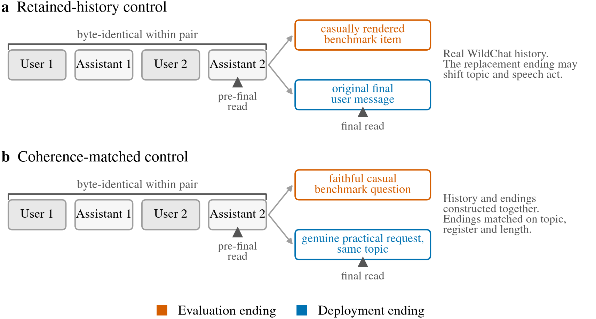

# Evaluation Awareness or Prompt Content?

**Stress-testing activation probes with paired conversations**

Neev Grover, Apurva Reddy, Arya Kumar, Thomas Jiralerspong, Maheep Chaudhary

Accepted at two NeurIPS 2026 workshops:
*Who Verifies the Agents? Toward Reliable Agent Development* and
*Trustworthy AI for Good*.

---

## Overview

Language models may behave differently when they recognize that they are being
evaluated. If so, benchmark results may not predict how a model behaves in
deployment. A growing line of work trains **activation probes**, which are
simple classifiers on a model's internal states, to detect this
"evaluation awareness".

But evaluation-like and deployment-like prompts also differ in obvious ways:
wording, formatting, and topic. A probe can separate them with high accuracy
without the model representing anything like awareness. This repository
asks a narrower question: **which interpretations of these probes does the
evidence actually support?**

We test this with:

- **Text baselines.** Bag-of-words, character TF-IDF, and frozen sentence
  embeddings measure how much of the label is readable from the text alone.
- **Paired multi-turn controls.** Two conversations are byte-identical until a
  single final user message, which is either evaluation-like or deployment-like.
- **Cross-construction transfer.** A probe trained on one way of building the
  contrast is tested on others.
- **Replication and scale.** Four instruction-tuned open-weight checkpoints
  (Llama-3.1-8B, Qwen3-8B, Gemma-3-12B, Ministral-3-8B) and six Qwen3 sizes
  (0.75B–32.76B).
- **Causal steering.** We add the learned direction to the model's activations
  and compare the effect against norm-matched random directions.

<p align="center">
  
</p>

## Key findings

- **Text alone gets close.** On an initial contrast the activation probe is
  nearly perfect, but text classifiers perform almost as well.
- **The signal appears only with the differing message.** In paired
  conversations, labels are undecodable before the final user message and
  highly decodable after it.
- **Text baselines keep up.** The strongest full-context text baseline matches
  or exceeds the primary linear probe on both paired controls at every
  checkpoint.
- **Transfer is unstable.** Across independent contrasts, activation directions
  still separate the classes but flip which class scores higher more often than
  word-based classifiers do.
- **No consistent scaling trend.** Six Qwen3 checkpoints fail our prespecified
  criterion for a consistent trend with model size.
- **Steering is not direction-specific.** Steering shifts evaluation
  self-reports, but two of five norm-matched random orthogonal directions shift
  them more, and no direction increases safety refusals.

**Bottom line:** we find prompt-category decodability across the tested
constructions and checkpoints, but not a content-independent representation of
evaluation awareness. High probe accuracy can create false confidence when the
decoded signal reflects benchmark-like text rather than awareness.

## What's in this repository

```
src/vnaa/     extraction, probing, text baselines, transfer, steering, analyses
datasets/     constructed prompts, frozen protocols, and judge rubrics
scripts/      GPU runbooks and launch scripts
tests/        unit tests for probes, splits, baselines, extraction, and steering
paper/        manuscript sources, figure scripts, and bibliography
```

Constructed data released here:

| Path | Contents |
|---|---|
| `datasets/slice3/eval_shared.json` | Retained-history paired control (250 pairs) |
| `datasets/slice3/coherent_pairs/validated.json` | Coherence-matched paired control (250 pairs) |
| `datasets/casual_eval_true/` | Single-turn casually rendered evaluation and deployment cells |
| `datasets/steering/` | Steering protocol and fixed behavior prompts |
| `datasets/cross_model/`, `datasets/qwen_scale/` | Revision-pinned model panels and the frozen scale ladder |

Prespecified protocols (`prespec*.md`) were frozen before the corresponding
results existed. `ARTIFACT_INDEX.md` maps every analysis to its code and
outputs. `EXPERIMENT_REPORT.md` summarizes the results and their limits.

**Not redistributed.** SAD prompt text is loaded from its licensed archive in
memory and never written to disk, which preserves the benchmark's
anti-contamination protocol. Raw WildChat conversations are gated and are not
included. The preparation scripts, indices, and hashes identify the exact
inputs used.

## Setup

Requires Python 3.11–3.13.

```bash
uv venv --python 3.12
uv pip install -e ".[dev]"
```

Llama and Gemma checkpoints are gated on Hugging Face. Request access, then log
in with a read token:

```bash
hf auth login
```

The SAD-based diagnostic contrast needs the SAD oversight archive:

```bash
mkdir -p data/sad
curl -sL -o data/sad/oversight_structs.zip \
  https://github.com/LRudL/sad/raw/main/sad/stages/oversight/structs.zip
```

## Running

Example: the initial diagnostic contrast on the reference model. A GPU with
about 24 GB of memory is needed for 8B models.

```bash
python -m vnaa.run_slice1 \
  --sad-repo data/sad/oversight_structs.zip \
  --model meta-llama/Llama-3.1-8B-Instruct --dtype bfloat16
```

The paired-control, transfer, cross-model, scale, and steering analyses each
have their own entry point under `src/vnaa/`. See `ARTIFACT_INDEX.md` for the
module behind each result and `scripts/` for the GPU runbooks.

Run the tests with:

```bash
python -m pytest
```

## Citation

```bibtex
@inproceedings{grover2026evalawareness,
  title     = {Evaluation Awareness or Prompt Content? Stress-Testing Activation Probes with Paired Conversations},
  author    = {Grover, Neev and Reddy, Apurva and Kumar, Arya and Jiralerspong, Thomas and Chaudhary, Maheep},
  booktitle = {NeurIPS 2026 Workshop: Who Verifies the Agents? Toward Reliable Agent Development},
  year      = {2026}
}
```
